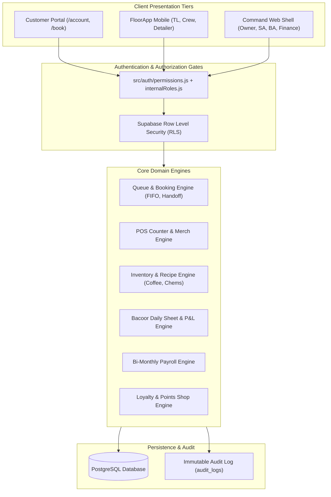
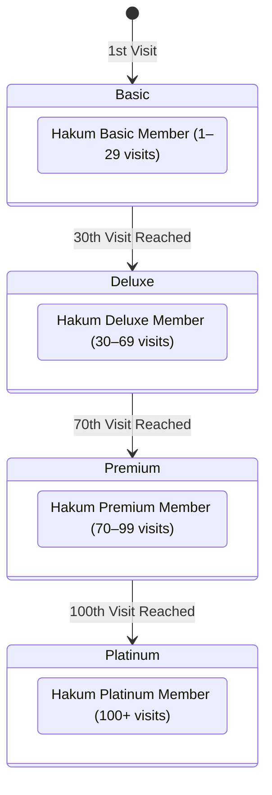
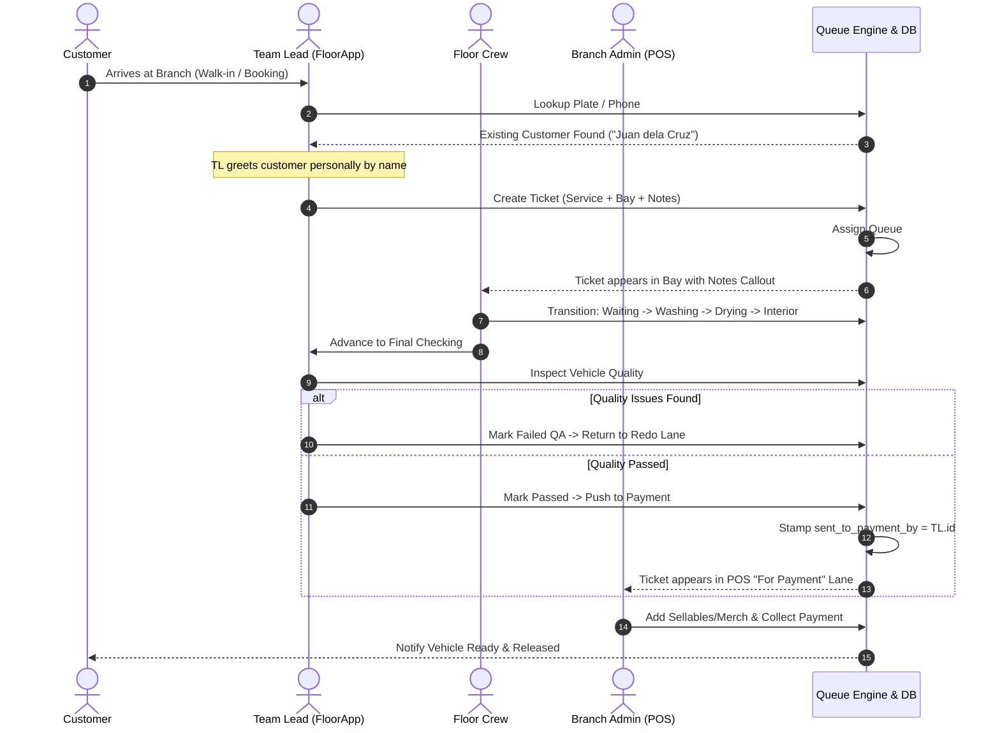
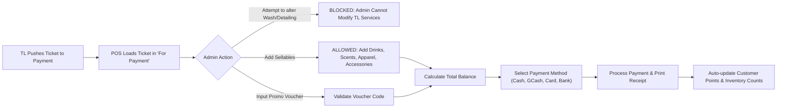
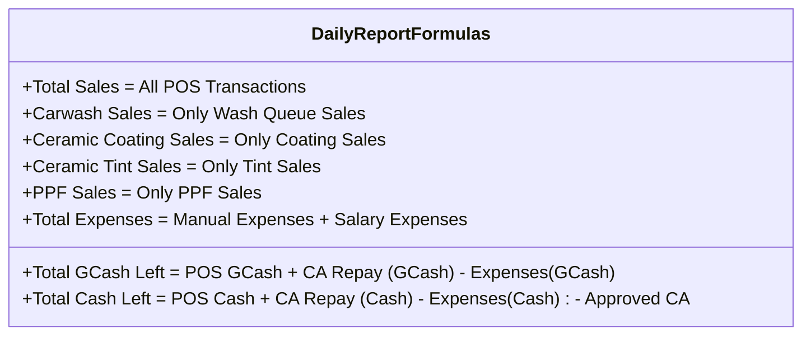
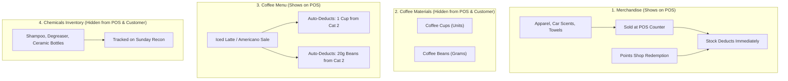
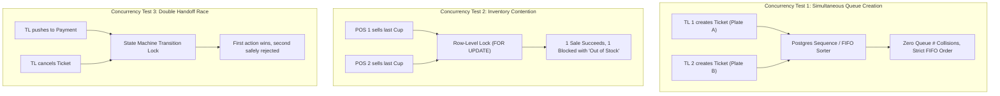

# Hakum Auto Care — Master System Test Plan & Quality Assurance Specification
**Author:** Principal Architect & QA Lead  
**Document Version:** 2.0.0 (Production Verification Standard)  
**Status:** Approved for Verification  
**Applies to:** Web Command Shell, FloorApp Mobile PWA, Customer Portal, Backend APIs & Supabase RLS  

---

## 1. Executive Architecture & Testing Strategy Overview

This document provides the definitive, end-to-end test specification for the Hakum Auto Care platform. It covers every user persona, operational workflow, administrative governance boundary, financial calculation formula, and concurrency condition across all branches (Bacoor, Dasmariñas, Batangas, and Network HQ).

### 1.1 Architectural Seams & Trust Boundaries

The system is architected around strict public seams and isolation boundaries:



### 1.2 Reviewer Directives & Quality Principles

- **/architect-review (Principal Engineer):** Every workflow enforces data ownership, single sources of truth, and strict module boundaries. No direct cross-domain mutation is permitted without audit records and state machine transitions.
- **/code-reviewer (Lead Software Engineer):** All test cases specify prerequisites, exact execution steps, expected outcomes, edge cases, and failure modes. Zero tolerance for unhandled exceptions or cryptic errors.
- **/architecture-efficiency-reviewer (Principal Architect):** Queries use indexed foreign keys (`staff_id`, `branch_slug`, `booking_id`). Bulk actions use batch RPCs. Concurrency protects against deadlocks, race conditions, and duplicate ledger entries.
- **/tdd (Test-Driven Development):** Every test scenario defines public seams, inputs, expected state changes, and automated test assertions. Red-Green-Refactor verification ensures tests survive internal refactors.

---

## 2. Global RBAC & User Persona Matrix

| User Account | Group / App Role | Branch Scope | Floor Insight | Carwash Queue | Detailing Schedule | Team Planner | POS Counter | Vouchers | Financials | Human Resources | Customers CRM | Special Governance Notes |
|:---|:---|:---|:---:|:---:|:---:|:---:|:---:|:---:|:---:|:---:|:---:|:---|
| **Michihiko** | Owner (`BossMich`) | All | **Full** | **Full** | **Full** | **Full** | **Full** | **Full** | **Full** | **Full** | **Full** | Sole role with access to Floor Insight dashboard |
| **Robert** | Super Admin (`BossMich`) | All | **None** | **Full** | **Full** | **Full** | **Full** | **Full** | **Full** | **Full** | **Full** | Full network admin; Floor Insight disabled (`floor_insight: false`) |
| **Lucy** | Super Admin (`BossMich`) | All | **None** | **Full** | **Full** | **Full** | **Full** | **Full** | **Full** | **Full** | **Full** | Full network admin; stock modification authority; Floor Insight disabled |
| **Bryan** | General Admin (`assistant_super_admin`) | All | **None** | **Full** | **Full** | **Partial** | **None** | **None** | **None** | **Read** | **Partial** | Cash advance board hidden; HR read-only; CRM create/modify (no SMS blast) |
| **Jaycee** | Bacoor Team Lead (`team_lead`) | Bacoor | **None** | **Full** | **Full** | **Partial** | **None** | **None** | **None** | **None** | **Read** | Personal clock on dock; queue master; Cash advance board hidden |
| **Rovi** | Dasma Team Lead (`team_lead`) | Dasma | **None** | **Full** | **Full** | **Partial** | **None** | **None** | **None** | **None** | **Read** | Scoped to Dasmariñas branch only |
| **Kyle / Rex** | Batangas Team Leads (`team_lead`) | Batangas | **None** | **Full** | **Full** | **Partial** | **None** | **None** | **None** | **None** | **Read** | Scoped to Batangas branch only |
| **Peter / Jennica**| Bacoor Admin (`admin`) | Bacoor | **None** | **Read** | **Read** | **Partial** | **Full** | **None** | **None** | **None** | **Partial** | POS checkout; Daily Sheet submission; cannot edit TL tickets in queue |
| **Sam / Almirra** | Batangas Admin (`admin`) | Batangas | **None** | **Read** | **Read** | **Partial** | **Full** | **None** | **None** | **None** | **Partial** | Scoped to Batangas; POS checkout; cannot edit stock directly |
| **Floor Crew** | Day Crew (`staff`) | Branch | **Watch** | **None** | **None** | **Forms** | **None** | **None** | **None** | **Clock** | **None** | Geofenced clock; My Tasks; Equipment repair & CA forms |
| **Detailer** | Detailing Crew (`detailer`) | Branch | **None** | **None** | **Status** | **Forms** | **None** | **None** | **None** | **Clock** | **None** | Detailing kanban status advances; clock-in; CA forms |
| **Marketing** | Marketing (`marketing`) | All | **None** | **Read** | **Read** | **Partial** | **None** | **None** | **None** | **None** | **Read** | Push notifications & broadcasts; CRM read-only |
| **Customer Rep** | Sales Desk (`sales`) | All | **None** | **Read** | **Read** | **Partial** | **None** | **None** | **None** | **None** | **Partial** | CRM create/modify + customer reports; Detailing appointment intake |
| **Investor** | Investor (`investor`) | Branch | **None** | **Read** | **Read** | **None** | **Read** | **None** | **Read** | **None** | **None** | View-only POS, Queue, and Financials for assigned branch |
| **Customer** | Customer (`customer`) | Network | N/A | Own | Own | N/A | N/A | Own | N/A | N/A | Own | Customer portal (`/account`), booking, points shop, review card |

---

## 3. Workflow 1: Customer Journey & Experience

### 3.1 Account Creation, Walk-in Claim & Authentication

#### Happy Path
1. **New Customer Online Sign Up:**
   - Navigate to `/signup`.
   - Enter Full Name, Mobile Phone (`0917XXXXXXX`), Email, and Password.
   - System normalizes phone to `+63917XXXXXXX` or standard Philippine 11-digit format.
   - Account created in `customers` table; auto-logs into `/account`.
2. **Walk-in Customer Claim:**
   - Customer who previously visited as an unauthenticated walk-in signs up with the same phone number.
   - System executes `claimWalkInHistory(phone)`.
   - All past walk-in bookings and vehicle associations automatically attach to the new customer profile.
   - Welcome banner displays: *"We found your previous visit history and linked it to your account."*

#### Edge Cases & Failed Paths
- **Duplicate Phone Number:** Enter a phone number already registered to another active account. System displays clear inline error: *"An account with this phone number already exists. Please sign in."*
- **Malformed Phone:** Enter `12345` or international numbers without country code. System blocks submit with regex validation warning.
- **Session Expiry:** Expired JWT token on protected customer routes redirects gracefully to `/signin` with return URL preserved.

### 3.2 Vehicle Registration & Size Auto-Detection

#### Happy Path
1. In Customer Portal or during booking, select **Add Vehicle**.
2. Enter Plate Number (e.g., `ABC 1234`), Make (`Toyota`), Model (`Fortuner`), Year (`2022`).
3. System normalizes plate format (strips extraneous whitespace and punctuation).
4. System queries `vehicle_catalog` to auto-resolve vehicle size category:
   - Sedan / Hatchback (e.g., Vios, Wigo) &rarr; `small`
   - Compact Crossover (e.g., Corolla Cross) &rarr; `medium`
   - Midsize SUV / Pickup (e.g., Fortuner, Hilux) &rarr; `large`
   - Full-size SUV / Van (e.g., Land Cruiser, HiAce) &rarr; `extra_large`
5. Vehicle saves linked to customer with verified size tag.

#### Edge Cases & Failed Paths
- **Duplicate Plate Across Users:** Attempting to register a plate owned by another user prompts ownership transfer validation.
- **Uncataloged Vehicle:** If make/model is not in catalog, system provides manual size picker dropdown with helper illustrations.

### 3.3 Public Booking Flow (Bay Wash & Detailing)

#### Happy Path
1. Navigate to `/book`.
2. Step 1: Select Branch (Bacoor, Dasmariñas, or Batangas).
3. Step 2: Select Vehicle (pre-loaded from profile or quick-add).
4. Step 3: Select Service Category:
   - **Car Wash:** Regular bay queue reservation.
   - **Detailing / Ceramic Coating / Tint / PPF:** Multi-hour scheduled appointment.
5. Step 4: Pick Date and available Time Slot (evaluated against branch bay capacity).
6. Step 5: Optional special instructions/notes (e.g., *"Child car seat in back, do not remove"*).
7. Submit booking: Booking record created with status `confirmed` (or `pending` for custom detailing requests).
8. Customer receives instant confirmation SMS & in-app notification.

#### Edge Cases & Failed Paths
- **Fully Booked Slot:** Selecting a time slot where bay capacity is exceeded disables the slot and displays the next available opening.
- **Booking Past Dates:** Calendar picker disables historical dates and enforces branch operating hours (e.g., 8:00 AM – 6:00 PM).

### 3.4 Live Queue Tracking & 15-Minute Delayed Rating Card

#### Happy Path
1. When customer arrives and Team Lead creates or checks in ticket, customer portal displays real-time progress bar:
   - `Waiting` &rarr; `Washing` &rarr; `Drying` &rarr; `Interior Detailing` &rarr; `Final Checking` &rarr; `Ready for Payment`
2. Customer receives SMS when vehicle enters `Final Checking`: *"Your vehicle ABC 1234 is undergoing final quality inspection."*
3. Once POS checkout is completed and vehicle released:
   - Status changes to `Completed`.
   - Rating card is suppressed for exactly 15 minutes (`rateVisitReminders.mjs`).
4. Exactly 15 minutes post-completion, the Customer Portal surfaces the interactive Star Rating & Review prompt.
5. Customer submits rating (1–5 stars) and feedback; record saves to `reviews` table and notifies Branch Admin.

---

## 4. Workflow 2: Loyalty, Rewards & Points Shop

### 4.1 Points Accumulation Matrix (22 Service SKUs)

Every paid transaction automatically credits loyalty points to the customer profile according to the strict business rules:

| Category | Service Name | Points Credited | Automated Verification Rule |
|:---|:---|:---:|:---|
| **Car Wash** | Premium Car Wash | **1 pt** | `points_award === 1` on paid POS sale |
| | Express Wash | **2 pts** | `points_award === 2` |
| | Basic Wash | **3 pts** | `points_award === 3` |
| | Deluxe Wash | **4 pts** | `points_award === 4` |
| **Paint Care** | Paint Maintenance | **5 pts** | `points_award === 5` |
| | Paint Refresh | **5 pts** | `points_award === 5` |
| **Glass & Trims** | Glass Cleaning | **3 pts** | `points_award === 3` |
| | Headlight Restore | **3 pts** | `points_award === 3` |
| | Black Trims Restore | **3 pts** | `points_award === 3` |
| | Glass Detailing | **5 pts** | `points_award === 5` |
| | Glass Coating | **5 pts** | `points_award === 5` |
| **Ceramic Coating**| Classic Ceramic Coating | **15 pts** | `points_award === 15` |
| | Premium Ceramic Coating | **20 pts** | `points_award === 20` |
| | Platinum Ceramic Coating | **25 pts** | `points_award === 25` |
| **Ceramic Tint** | Nano Ceramic Tint | **10 pts** | `points_award === 10` |
| | Nano Ceramic Pro Tint | **15 pts** | `points_award === 15` |
| | Nano Ceramic Pro Black Series Tint | **20 pts** | `points_award === 20` |
| **Interior** | Interior Detailing | **10 pts** | `points_award === 10` |
| | Interior Deep Cleaning | **5 pts** | `points_award === 5` |
| **PPF** | High Impact Partial PPF | **30 pts** | `points_award === 30` |
| | Basic PPF | **40 pts** | `points_award === 40` |
| | Ultimate PPF | **50 pts** | `points_award === 50` |
| | Platinum PPF | **60 pts** | `points_award === 60` |

### 4.2 Milestone Visit Rewards (Cumulative Visits Across All Cars)

Visit rewards accrue based on the customer's total visit count, regardless of whether different vehicles are used:

- **Every 6th visit (6, 12, 18, 24, 30...):**
  - **Visit 6:** FREE Car Freshener
  - **Visit 12:** FREE Coffee
  - **Visit 18:** FREE Premium Car Wash
  - **Visit 24:** FREE Bac-to-Zero Add-on Service
  - **Visit 30:** 15% OFF on Tint, Ceramic Coating, or PPF (Customer choice)
- **POS Interface Trigger:** When ringing up an eligible milestone visit, POS automatically displays a prominent green alert banner indicating the earned free item/perk.

### 4.3 Customer Membership Tiers

Customer tier dynamically evaluates based on total completed lifetime visits:



### 4.4 Points Shop & Inventory-Linked Merch Redemption

#### Points Shop Catalog & Values
- **Hakum Key Chain:** 20 pts
- **Clear Pro Mug:** 30 pts
- **Clear Pro Yellow Bag:** 30 pts
- **Hakum Car Scent:** 30 pts
- **Air Spencer:** 30 pts
- **Hakum Shirt:** 50 pts
- **Hakum Car Care Kit:** 50 pts
- **Fusso Coat Spray:** 50 pts
- **Luxury Gloss Spray:** 50 pts
- **Clear Pro Coffee Kit:** 60 pts

#### Redemption & Handover Workflow
1. Customer opens Points Shop in Portal (`/account` &rarr; Points Shop).
2. Customer selects item (e.g., *Hakum Shirt*, 50 pts) and designates pickup branch (e.g., *Bacoor*).
3. System verifies `points_balance >= item.points_price`.
4. System verifies branch stock on-hand (`branch_inventory.qty > 0`).
5. Transaction executes atomically via RPC `redeem_points_item`:
   - Customer points deducted (`-50 pts`).
   - Claim record created with QR code / claim token and status `pending_pickup`.
   - Item stock in designated branch is reserved.
6. Customer visits branch and presents claim token to Branch Admin at POS.
7. Branch Admin opens **Points Shop Handover** modal in POS, scans or enters token.
8. Branch Admin confirms item handover:
   - Claim status updates to `fulfilled`.
   - Branch on-hand inventory count atomically decrements by 1.
   - Handover logged in audit ledger with Admin `staff_id` stamp.

#### Failure Modes
- **Insufficient Points:** "Redeem" button disabled; tooltips shows points needed.
- **Out of Stock at Branch:** If branch has 0 units, UI displays: *"Out of stock at Bacoor. Select another branch or check back soon."*
- **Double Claim / Replay Attack:** Attempting to scan an already fulfilled token displays error: *"Claim already fulfilled on [Date] by [Staff Name]."*

---

## 5. Workflow 3: Crew Operations (`staff` & `detailer`)

### 5.1 Geofenced Clock-in & Attendance Headcount

#### Happy Path
1. Crew arrives at assigned branch shopfront.
2. Opens FloorApp &rarr; Attendance tab.
3. Clicks **Clock In**. Browser requests GPS coordinates.
4. System validates distance against branch geofence radius (e.g., $\le 100$ meters of Bacoor branch coordinates).
5. Compares current Manila timestamp against shift start time (e.g., 8:00 AM):
   - Arrived $\le 8:00\text{ AM}$ &rarr; Status `present`.
   - Arrived $> 8:00\text{ AM}$ &rarr; Status `late`.
6. Attendance record inserts into `staff_attendance` for today's date.
7. **Attendance Summary Formatting:** System aggregates branch attendance into standard format:
   ```text
   Bacoor Branch
   Crew - 8 out of 10
   Team Lead - 2 out of 2
   Admin - 1 out of 2
   ```
8. **Administrative Separation:** Administrative crew (`admin`, `assistant_super_admin`, `super_admin`) are filtered out from the active Floor board display.

#### Edge Cases & Failed Paths
- **Geofence Violation:** Crew attempts to clock in 500 meters away from shop. System rejects: *"You are outside the branch geofence (500m away). Please clock in on-site."*
- **Mock Location / Spoofing:** Mock location alert triggers in audit log and flags record for Super Admin review.
- **Double Clock-in:** Second click returns existing session without creating duplicate rows.

### 5.2 "My Tasks" & Customer Notes Visibility

#### Happy Path
1. Crew member clocks in and navigates to **My Tasks**.
2. Displays vehicles currently assigned to their bay.
3. **Critical Notes Requirement:** Customer and Team Lead notes are prominently displayed in a high-contrast amber callout banner on every task card:
   - Example: *"[NOTE from TL]: Customer requested extra care on front bumper paint protection film."*
4. Crew completes stage (e.g., washing) and clicks **Mark Stage Complete**.
5. Ticket advances to next bay; Team Lead queue board updates in real time.

### 5.3 Ops Forms: Equipment Repair & Cash Advance

#### Equipment Repair Request (Crew Only)
1. Crew opens FloorApp &rarr; Forms &rarr; **Equipment Repair**.
2. Selects equipment (e.g., *Pressure Washer Bay 2*, *Vacuum 3*), severity (*Urgent / Routine*), and description.
3. Submits form: Alert routed directly to Team Lead and Super Admin dashboard.
4. Non-crew roles attempting to submit equipment repairs are denied by RLS policy.

#### Cash Advance Request
1. Crew member selects **Cash Advance Request**.
2. Inputs requested amount (e.g., ₱1,000.00) and reason.
3. System checks existing outstanding debt from `staff_profiles.cash_advance_balance`.
4. Request submits with status `pending_approval` for Super Admin / Owner decision.

---

## 6. Workflow 4: Team Lead Floor Operations (`team_lead`)



### 6.1 FIFO Queue Ordering & Customer Recognition

#### Happy Path
1. Team Lead opens Carwash Queue (`/operations/queue`) on mobile FloorApp.
2. Clicks **New Ticket**.
3. Inputs vehicle plate (e.g., `NDX 5432`).
4. **Instant Customer Recognition:**
   - System immediately queries customer and vehicle history.
   - When existing customer is found, UI displays banner:
     **"Welcome Back: Juan dela Cruz (Hakum Deluxe Member — 42 Visits)"**
   - Prompts Team Lead: *"Greet Mr. dela Cruz by name."*
5. Team Lead inputs customer special requests in **Notes** field (Step 1).
6. Selects package/service (e.g., *Deluxe Wash + Bac-to-Zero*).
7. Assigns primary crew and initial bay.
8. Submits ticket:
   - **FIFO Rule 1:** The new ticket appends to the **bottom** of the active FIFO processing queue.
   - **FIFO Rule 2:** Live board display sorts entries so Team Lead knows exactly which car arrived first and is next in line.
   - Unique queue ticket number generated (e.g., `#04`).

#### Edge Cases & Failed Paths
- **New Customer Walk-in:** Plate not found prompts quick customer registration (Name + Phone). Submits seamlessly without interrupting queue intake.
- **Missing Required Notes:** If customer has detailing add-on, notes field highlights to capture vehicle pre-existing scratches/dents.

### 6.2 Bay Lifecycle & Failed QA Redo Lane

#### Happy Path
1. Ticket progresses through stages: `Waiting` &rarr; `Washing` &rarr; `Drying` &rarr; `Interior Detailing`.
2. Vehicle moves to `Final Checking`.
3. Team Lead conducts rigorous physical inspection against quality checklist.
4. **Failed QA Redo Path:**
   - If water spots, dirt, or streaks are found, Team Lead clicks **Mark Failed QA**.
   - Team Lead selects corrective bay (e.g., *Washing* or *Drying*) and specifies reason (e.g., *"Rear rim brake dust remaining"*).
   - Ticket routes to **Redo Lane** (`redo_lanes`).
   - Crew prioritizes vehicle; corrective action performed.
   - Vehicle returns to `Final Checking`.
5. **Quality Passed:**
   - Team Lead clicks **Pass Inspection**.

### 6.3 Handoff to Payment & Ticket Lock

#### Happy Path
1. Upon passing inspection, Team Lead clicks **Push to Payment**.
2. System executes atomic handoff (`queuePaymentHandoff.mjs`):
   - Ticket status updates to `for_payment`.
   - Records audit timestamp `sent_to_payment_at` and `sent_to_payment_by = TL.id`.
   - **Strict Write Lock Enforced:** From this moment, Team Lead can no longer cancel or delete the ticket without Admin authorization.
   - Ticket immediately appears in POS Counter queue for Branch Admin checkout.

---

## 7. Workflow 5: Branch Admin POS, Cash & Day Close (`admin`)

### 7.1 POS Counter Checkout & Sellables Addition



#### Happy Path
1. Branch Admin opens POS (`/operations/pos`) at branch counter.
2. Selects incoming ticket `#04 (Plate NDX 5432)`.
3. **Admin Service Modification Lock (Note 5):**
   - Services and detailing packages configured by Team Lead are **read-only** (locked).
   - Branch Admin **cannot** delete, swap, or reprice the services.
   - If customer requests service changes, Admin directs Team Lead to adjust from TL FloorApp.
4. **Adding Sellable Items (Note 6):**
   - Admin can add non-service retail items to the checkout:
     - Merchandise (Hakum Shirt, Microfiber towels).
     - Refreshments (Iced Americano, Mineral Water).
     - Car Accessories (Air Spencer, Scent clip).
5. **Voucher Promo Code Entry (Note 14):**
   - Admin enters customer promo voucher code (e.g., `HAKUM15OFF`).
   - System validates voucher against branch, expiration, and service category.
   - 15% discount applies to eligible service line.
6. **Payment Processing:**
   - Admin selects payment method: **Cash**, **GCash**, **Credit/Debit Card**, or **Bank Transfer**.
   - If GCash / Card / Transfer: enters reference number.
   - If Cash: enters tendered amount; system calculates exact change.
7. Click **Complete Checkout**:
   - Ticket marks `paid` and `completed`.
   - Visit count increments on customer profile.
   - Loyalty points credit to customer account.
   - Retail inventory on-hand decrements automatically.
   - Audio announcer alerts: *"Payment received for ticket number four."*

#### Edge Cases & Failed Paths
- **Expired Voucher:** Entering expired voucher displays error: *"Voucher expired on [Date]"* and blocks discount.
- **Insufficient Cash Tendered:** Entering cash tender less than total sale disables complete button.

### 7.2 Cash Advance Payouts & Drawer Debt Tracking

#### Cash Advance Payout Workflow (Note 7 & 13)
1. Employee (e.g., Crew John) requests cash advance at counter.
2. Branch Admin opens POS &rarr; **Cash Advance** tab.
3. Admin selects Employee Name from active staff dropdown.
4. **Dynamic Debt Display (Note 13):**
   - System immediately displays employee's current outstanding balance:
     **"John Doe — Outstanding Debt: ₱1,500.00"**
5. Admin inputs payout amount (e.g., ₱500.00) and notes.
6. Admin clicks **Disburse Cash Advance**:
   - Payout logs to daily drawer disbursements.
   - Employee profile balance increments: $\text{New Debt} = ₱1,500 + ₱500 = ₱2,000.00$.
   - **Crucial Accounting Rule:** Cash advance payout is **deducted from total money left in daily report, but is NOT an expense**.

#### Cash Advance Repayment Workflow
1. Employee pays back cash into the drawer (e.g., ₱1,000.00 cash).
2. Branch Admin selects **Record CA Repayment**.
3. Selects Employee Name and inputs payment amount.
4. Payout logs to `ca_repayments`:
   - Employee debt decrements: $\text{New Debt} = ₱2,000 - ₱1,000 = ₱1,000.00$.
   - **Accounting Rule:** Repayment is **added to total money left in daily report, but is NOT counted as revenue/income**.

### 7.3 Manual Operating Expenses Entry

#### Happy Path
1. Branch Admin opens POS &rarr; Daily Sheet &rarr; **Expenses**.
2. Clicks **Add Expense**.
3. **Mandatory Fields:**
   - **Expense Category (Required):** Cleaning Supplies, Tool Replacement, Food/Snacks, Branch Maintenance.
   - **Mode of Payment (Required):** Selects either **Cash** (from drawer) or **GCash**.
   - **Amount (Required):** Peso value.
   - **Notes / Receipt Photo:** Description.
4. **Salary Lines Inclusions:**
   - End-of-day wash pool salary, detailer salary, and tinter salary automatically populate as expense previews based on approved compensation rules.
5. Saves expense draft.
6. **Financial Integration:** When Daily Sheet is approved by Super Admin, all manual expenses and salary lines automatically post to the master Finance app as branch operating expenses.

### 7.4 Shift Close & End-of-Day Financial Reconciliation

At close of business, Branch Admin executes the Daily Sheet reconciliation. Every number must balance against the verified mathematical formulas:



#### Exact Mathematical Definitions
1. **Total Sales:**
   $$\text{Total Sales} = \sum \text{All POS Completed Transactions (Cash + GCash + Card + Bank)}$$
2. **Category Sales Isolation (Pure Services Only):**
   - $\text{Car Wash Sales} = \sum \text{Car Wash Queue Transactions}$ *(Excluding refreshments, accessories, merch)*
   - $\text{Ceramic Coating Sales} = \sum \text{Ceramic Coating Sales}$ *(Excluding retail add-ons)*
   - $\text{Ceramic Tint Sales} = \sum \text{Ceramic Tint Sales}$ *(Excluding retail add-ons)*
   - $\text{PPF Sales} = \sum \text{Paint Protection Film Sales}$ *(Excluding retail add-ons)*
3. **Total Expenses:**
   $$\text{Total Expenses} = \sum \text{Manual Expenses} + \text{Carwash Salary} + \text{Detailer Salary} + \text{Tinter Salary}$$
4. **Cash Advance Isolation:**
   - Cash Advance Disbursed: Deducted from Cash Left; **NOT** an expense.
   - Cash Advance Repayments: Added to Cash/GCash Left; **NOT** sales income.
5. **Total GCash Left in Drawer / Account:**
   $$\text{Total GCash Left} = \text{POS GCash Sales} + \text{CA Repayments (GCash)} - \text{Expenses Paid via GCash}$$
6. **Total Cash Left in Physical Drawer:**
   $$\text{Total Cash Left} = \text{POS Cash Sales} + \text{CA Repayments (Cash)} - \text{Expenses Paid via Cash} - \text{Approved CA Disbursed (Cash)}$$

#### Submission to Super Admin
1. Admin counts physical cash in drawer and enters actual counted cash.
2. If discrepancy exists between calculated cash left and counted cash, system flags overage/shortage.
3. Admin clicks **Submit Daily Sheet for Approval**.
4. Sheet locks in state `pending_approval`; notifications dispatched to Lucy, Robert, and Michihiko.

---

## 8. Workflow 6: Inventory Management & Approval Governance

### 8.1 The Four Inventory Categories & Recipe Deductions



### 8.2 Inventory RBAC & Restock Approval Workflow (Notes 15, 17, 18)

1. **Branch Admin Restock Request (Zero Cost Addition):**
   - Branch Admin opens `/operations/inventory` &rarr; Restock tab.
   - Selects item and enters added quantity (e.g., `+50 units Hakum Shampoo`, `+100 Cups`).
   - **Zero Cost Rule (Note 18):** Adding restock **does not incur or record financial cost**. All costs are handled in bulk invoices in the Finance app.
   - **Branch Admin Write Lock:** Branch Admin **cannot** directly edit or overwrite the existing stock count.
   - Request submits to Central Approvals with status `pending`.
2. **Super Admin Central Approval:**
   - Super Admin (Lucy or Robert) or Owner (Michihiko) opens `/operations/approvals`.
   - Reviews pending restock requests by branch.
   - Clicks **Approve**:
     - System executes RPC `review_restock(id, 'approved')`.
     - Physical on-hand count atomically updates in `branch_inventory`.
     - Transaction logged with approving admin's ID.
3. **Stock Modification Authority:**
   - Only **Owner (Michihiko), Lucy, and Robert** have authority to manually override inventory counts directly (`canModifyStock`).

---

## 9. Workflow 7: Central Administration, HR & Payroll

### 9.1 People & RBAC Delegation (`/operations/people`)

1. Super Admin opens `/operations/people`.
2. Can provision new staff accounts or edit existing permissions.
3. **Branch Delegation Scope:**
   - Single-branch assignment (e.g., Peter assigned strictly to `bacoor`).
   - Multi-branch assignment (e.g., floaters or supervisors).
   - Network-wide assignment (Owner, Super Admin, Marketing, Sales).
4. **General Admin Granular Grants:**
   - Toggle specific grants: `finance_write`, `planning_edit`, `crm`, `pos`, `queue_all`.
5. Changes take effect in real time upon next token refresh.

### 9.2 Bi-Monthly Payroll Engine (Office & Management)

1. Super Admin opens `/operations/monthly-payroll`.
2. Selects Pay Period (1st–15th or 16th–End of Month) and Branch.
3. Displays roster of salaried and office staff (excluding day crew who are paid on the Daily Sheet).
4. System computes base salary according to agreed bi-monthly rate.
5. Super Admin / ASA can enter manual **Incentives / Bonuses** (Note 26).
6. **No Tax Deduction Rule (Note 24):** Payroll calculates clean gross = net take-home without statutory tax withholdings.
7. System generates digital payslips for each employee.
8. Employee receives payslip in FloorApp &rarr; Payslips tab.
9. Employee reviews breakdown and signs digital acknowledgment via **E-Signature**.
10. Payslip status updates to `acknowledged`.

---

## 10. Workflow 8: Owner Master Governance (`BossMich`)

### 10.1 Floor Insight Dashboard (Exclusive Access)

1. Owner Michihiko logs in and lands on `/operations/dashboard` (**Floor Insight**).
2. All other roles (Super Admin, General Admin, Team Lead, Branch Admin) attempting to route to `/operations/dashboard` are blocked and redirected to their role home (`canAccessFloorBoard`).
3. **Live Floor Telemetry Displayed:**
   - Total network vehicles in bays across all branches.
   - Bottleneck alerts (e.g., *"Bay 3 washing delayed > 35 minutes"*).
   - Real-time revenue pacing vs monthly targets.
   - Active failed QA rates and bay rework ratios.
   - Live branch headcount summary.

---

## 11. Workflow 9: Multi-User Concurrency & Race Conditions

To ensure stability when dozens of staff operate simultaneously across multiple branches, the following race condition test suite is specified:



### Concurrency Test Scenarios

1. **Simultaneous Queue Intake:**
   - 2 Team Leads at different terminals create tickets in the same millisecond.
   - *Verification:* Unique queue numbers assigned sequentially; zero deadlocks; both cards appear in correct FIFO order.
2. **Concurrent Inventory Checkout:**
   - Item stock = 1 unit. Cashier A and Cashier B click checkout simultaneously.
   - *Verification:* Postgres transaction row lock ensures first sale succeeds (stock &rarr; 0); second sale rejects with error: *"Item out of stock"*.
3. **Simultaneous Clock-in Spike:**
   - 10 crew members click Clock-In at exactly 7:59 AM.
   - *Verification:* All 10 attendance records save without duplicate key exceptions or dropped requests.
4. **Concurrent Daily Sheet Approval & Edit:**
   - Branch Admin attempts to add an expense while Super Admin is clicking Approve Sheet.
   - *Verification:* Approved sheet locks rows; late expense attempt is rejected with *"Sheet is already approved and locked."*

---

## 12. Complete Traceability Matrix & Automated Test Seams

Every capability is anchored to executable unit/integration tests in the test suite:

| Workflow Domain | Public Seam / API File | Unit / Integration Test File |
|:---|:---|:---|
| **RBAC Matrix** | `src/auth/permissions.js` | `tests/rbacMatrix.test.js`, `tests/permissions.test.js` |
| **Role Persona Coverage** | `src/auth/internalRoles.js` | `tests/rolePersonaCoverage.test.js`, `tests/roleGuideParity.test.js` |
| **Queue FIFO & Sizing** | `src/queue/queueLogic.js` | `tests/queueLogic.test.js`, `tests/queueLogicFifo.test.js` |
| **Customer Name Greeting** | `src/lib/queueCustomerName.js` | `tests/queueCustomerName.test.js` |
| **Payment Handoff Lock** | `server/queuePaymentHandoff.mjs`| `tests/queuePaymentHandoff.test.js` |
| **POS Cart & Restrictions** | `src/lib/posSale.js` | `tests/posSale.test.js`, `tests/posCartBranchAdmin.test.js` |
| **Loyalty & Points Catalog**| `src/lib/rewardsCatalog.js` | `tests/rewardsCatalog.test.js`, `tests/rewardsCatalogPoints.test.js` |
| **Points Shop & Claims** | `server/pointsShop.mjs` | `tests/pointsShop.test.js`, `tests/pointsShopMigration.test.js` |
| **Daily Report Calculations**| `src/lib/bacoorDailyReport.js` | `tests/bacoorDailyReport.test.js`, `tests/bacoorSampleReport.test.js` |
| **Cash Advance Debt Ledger** | `src/lib/cashAdvanceBalance.js` | `tests/cashAdvanceDebt.test.js`, `tests/cashAdvancePos.test.js` |
| **Attendance Headcount** | `src/lib/attendanceInsights.js` | `tests/attendanceInsights.test.js`, `tests/attendanceRoles.test.js` |
| **Inventory Categories & Recipe**| `src/lib/inventoryCatalog.js`| `tests/inventoryCategoriesRbac.test.js` |
| **Monthly Payroll & E-Sign**| `src/lib/payslip.js` | `tests/payslip.test.js`, `tests/payrollFullStack.test.js` |
| **15-Minute Review Delay** | `server/rateVisitReminders.mjs` | `tests/rateVisitReminders.test.js` |

---

## 13. End-to-End Master Quality Assurance Checklist

Use this checklist during staging releases and live production sanity checks:

### Section A: Customer Portal & Lifecycle
- [ ] New user signup normalizes phone and auto-creates profile.
- [ ] Existing walk-in customer signup automatically links past visits and vehicle history.
- [ ] Vehicle registration correctly maps model to size class (`small`, `medium`, `large`, `extra_large`).
- [ ] Public booking interface respects branch operating hours and capacity.
- [ ] Real-time queue progress bar reflects live stage transitions.
- [ ] SMS sent when vehicle enters Final Checking.
- [ ] 15-minute delay enforced before visit rating prompt appears.
- [ ] Customer profile displays accurate lifetime visits, tier badge, and points balance.

### Section B: Loyalty, Rewards & Merch Redemption
- [ ] Each of the 22 service SKUs credits exact specified points upon POS payment.
- [ ] Milestone rewards trigger on visits 6, 12, 18, 24, and 30 across different cars.
- [ ] Membership tiers transition accurately at 30, 70, and 100 visits.
- [ ] Points Shop displays all 10 merchandise items with correct points prices.
- [ ] Merch claim verifies points balance and branch inventory on-hand.
- [ ] POS pickup scan decrements branch merchandise stock count atomically.

### Section C: Crew Floor Operations
- [ ] Geofenced clock-in enforces radius check and flags on-time vs late.
- [ ] Attendance headcount matches `Branch Crew - X out of Y` format.
- [ ] Administrative crew excluded from Floor Insight board.
- [ ] My Tasks displays customer and Team Lead notes in high-visibility callouts.
- [ ] Equipment repair form submission permitted for crew and denied for others.
- [ ] Cash advance request records to employee debt ledger.

### Section D: Team Lead Queue & Detailing
- [ ] New queue ticket appends to bottom and sorts by arrival time (FIFO).
- [ ] Existing customer greeting banner displays customer name prominently.
- [ ] Notes entered in Step 1 persist across all stages to POS receipt.
- [ ] Failed QA button moves ticket to Redo Lane with corrective bay routing.
- [ ] "Push to Payment" locks ticket against TL modification and alerts POS.

### Section E: Branch Admin POS & Cash Management
- [ ] POS counter displays locked services (Branch Admin cannot alter TL packages).
- [ ] Branch Admin can add sellable merchandise, accessories, and drinks.
- [ ] Voucher promo codes apply valid discounts and reject expired codes.
- [ ] Cash advance payout displays debtor remaining balance before disbursing.
- [ ] Cash advance repayment into drawer increments cash left without creating sales income.
- [ ] Cash advance disbursement decrements cash left without creating an expense.
- [ ] Adding manual expense requires both Category and Payment Mode (Cash/GCash).

### Section F: Daily Sheet & End-of-Day Financials
- [ ] Total Sales matches sum of all POS transactions.
- [ ] Car Wash sales isolated strictly to wash queue lines.
- [ ] Detailing, Tint, and PPF sales isolated to respective category buckets.
- [ ] Total GCash Left matches POS GCash + CA Repayments (GCash) - Expenses (GCash).
- [ ] Total Cash Left matches POS Cash + CA Repayments (Cash) - Expenses (Cash) - Approved CA.
- [ ] Daily sheet submission locks draft and routes to Super Admin approval.

### Section G: Inventory & Recipe Management
- [ ] Merchandise shows on POS and decrements on sale/redemption.
- [ ] Coffee Menu sale auto-deducts 1 Cup and 20g Beans from Coffee Materials.
- [ ] Coffee Materials and Chemicals Inventory remain hidden from POS catalog.
- [ ] Branch Admin restock request incurs zero financial cost.
- [ ] Direct stock count override restricted to Owner, Lucy, and Robert.
- [ ] Restock requests update on-hand counts only after Super Admin approval.

### Section H: HR, Payroll & Approvals
- [ ] Central Approvals page lists pending restocks, expenses, and sheets.
- [ ] Bi-monthly payroll calculates clean take-home without tax deductions.
- [ ] Super Admin can add manual incentive bonuses to payroll slips.
- [ ] Employees can review and e-sign payslips in FloorApp.
- [ ] Only Owner Michihiko can access the Floor Insight dashboard.

---
*End of Master Test Plan — Hakum Auto Care Operational Excellence Standard*

