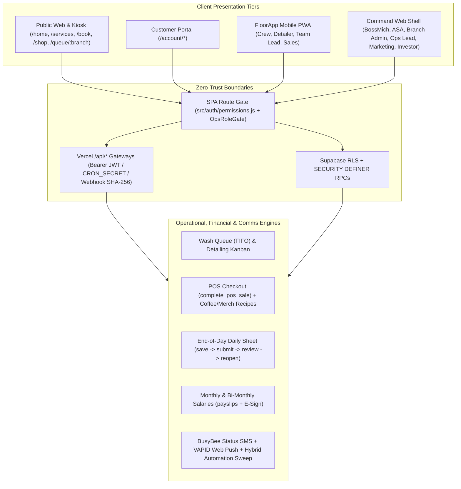
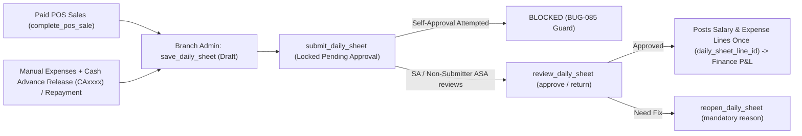

# Hakum Auto Care — Master System Test Plan & Exhaustive QA Checklist
**Document Version:** 3.0.0 (Graphify Full-System, Daily Ops, End-of-Day, Monthly Salaries & Full CRUD Edition)  
**Verified Against Live Architecture:** `graphify-out/` + `docs/GRAPHIFY_*.md` + `src/App.jsx` + `api/*` + `server/*`  
**Applies to:** Public Web, Customer Portal (`/account/*`), Kiosk TV (`/queue/:branch`), Command Web Shell & FloorApp PWA (`/operations/*`), `/api/*` Gateways, Web Push VAPID, BusyBee BrandTxt SMS & Supabase Postgres/RLS  

---

## 1. Executive Architecture, Graphify Inventory & Production Test Guardrails

### 1.1 Graphify System Inventory (Full Coverage Baseline)
| Layer | Live Inventory / Boundaries |
| :--- | :--- |
| **PostgreSQL Schema (RLS On)** | **92+ active tables** (`docs/GRAPHIFY_MEMORY.md`), **16 views** (incl. `public_queue_*`, `crew_kpi_summary`, `finance_daily_pl`, `operations_queue_board`), **74+ RPCs** (`docs/GRAPHIFY_DB_FULL.md`), **25 user triggers**, **146 FKs**, **245+ RLS policies** |
| **Critical Domain Engines** | Queue & Detailing (`bookings`), Floor Sales (`complete_pos_sale`), End-of-Day Cutover (`save_daily_sheet`, `submit_daily_sheet`, `review_daily_sheet`, `reopen_daily_sheet`), Office/Management Salaries (`payslips`, `/operations/monthly-payroll`), Inventory & Coffee Recipe (`product_branch_stock`, `inventory_recons`), Loyalty & Points Shop (`loyalty_ledger`, `accessory_redemptions`), Team Planner & Ops Forms (`plan_cards`, `ops_form_submissions`), Content Studio (`blogs`, `events`), Notifications & Hybrid Automation (`/operations/notifications`) |
| **Retired Legacy RPCs (Must Stay Revoked)** | `run_payroll`, `submit_shift_close`, `review_shift_close`, `complete_payment` — `EXECUTE` revoked from `anon`/`authenticated` (`e2e:daily-sheet-money` proves refusal) |
| **Serverless Gateways (`/api/*`)** | **10 Vercel functions** (`bookings`, `customer`, `data-center`, `demo-login`, `finance`, `health`, `notifications`, `public-inquiry`, `seo`, `staff`) routing **42 audited handlers** (`npm run audit:api-auth`) |
| **Storage Buckets** | Public read: `content-media`, `vehicle-photos` · Private RLS: `booking-updates`, `plan-proofs` |
| **Catalog & Vehicles** | **33 active services** (**12 detailing** + **21 wash/package/treatment**), **6 Coffee Menu**, **5 Sellables**, **492 cataloged vehicles** across 4 sizing classes (`small`, `medium`, `large`, `extra_large`) |

### 1.2 Architectural Trust Boundaries

### 1.3 Live Production Playwright & Security Execution Guardrails
1. **Target Domains & Dual-Host Security Boundary:**
   - **Main Domain (`https://www.hakumautocare.com`):** Full production Playwright E2E, SEO crawler headers, customer flows, and staff operations. **Quick Demo Chips MUST stay hidden** and `POST /api/demo-login` **MUST return `404`**.
   - **QA Vercel Domain (`https://hakumauto.vercel.app`):** Quick Demo Login chips (`?qa=<key>`) MUST work and `POST /api/demo-login` **MUST return `200`** with a short-lived session for valid QA keys only.
2. **Production Write Isolation Convention (Zero Dirty Data Left Behind):**
   - Every created test record on live production MUST carry identifiable QA prefixes:
     - **Vehicle Plate:** `QA-` prefix (e.g., `QA-901`, `QA-902`)
     - **Customer Name:** `QA Tester` / `QA Tester - <run>`
     - **Notes / Reason / Description:** `[QA-RUN-YYYY-MM-DD]`
     - **Catalog / Content / Forms:** `[QA]` or `qa-` slug prefix
   - After completing money, EOD Daily Sheet, and payroll sections, execute **Section N (Post-Run Teardown)** immediately: void QA POS sales/handoffs via sanctioned admin override, void test `payslips`/draft runs, archive `QA-` bookings/customers/catalog items, and delete temporary `user_notifications` test alerts.
3. **BusyBee BrandTxt Live SMS Cap (`09625294043` Only):**
   - Real outbound BrandTxt SMS messages during QA are sent **ONLY** to **`09625294043`**.
   - Cap live BusyBee sends to **10–15 messages (~₱10–15)** per full test run across verified Detailing/Services/Packages status milestones plus the Super Admin `Test Status SMS` health check.
   - Verify all remaining status gates, disabled statuses, non-eligible categories (e.g., merch/coffee), and quiet-hour deferrals directly in `sms_events` without spending extra SMS credits.
4. **TDD & Evidence Discipline (`/tdd` & `/verify`):**
   - Every automated test targets a public seam (route, RPC, `/api/*` handler, or exported domain rule in `src/lib/`), never private internals.
   - Never declare PASS without fresh terminal/browser exit-0 evidence, `0` console/page errors, `0` HTTP `5xx` responses, and `0px` horizontal overflow (`375px` mobile & `1440px` desktop).

---

## 2. Global RBAC & 18-Account Persona Matrix

Covers all 13 `profile_role` enum values and all 18 operational test accounts defined in `src/lib/demoAccounts.js` & `src/auth/permissions.js`:

| Persona / Account ID | Role Key | Branch Scope | Key Capabilities & Strict Boundaries |
| :--- | :--- | :--- | :--- |
| **Michihiko (`boss`)** | `BossMich` | All | Sole access to Floor Insight (`/operations/dashboard`), Data Center (`/operations/data-center`), Notification Settings edit/test/webhook rotation, direct stock override, approve Daily Sheets (incl. own) |
| **Robert / Lucy (`robert` / `boss` tier)** | `BossMich` (`floor_insight: false`) | All | Network Admin, Inventory override, Approvals, Daily Sheet review, Finance & Monthly Payroll; **blocked from Floor Insight** |
| **Bryan (`asa`)** | `assistant_super_admin` | All | Uses granular `permission_grants` (`pos`, `finance_view`, `finance_write`, `planning_edit`, `services_merch`, `crm`, `people`, `queue_all`, `reports`); Cash Advance planner board hidden; **cannot self-approve own Daily Sheet** |
| **Peter / Jennica (`admin`, `admin2`)** | `admin` | Assigned branch(es) | POS Checkout, Merch Handover, Cash Advance payout/repayment, Manual Expenses, Daily Sheet draft & submit; **queue read-only** (`canEditQueueOperations = false`); **cannot directly alter stock** (`canModifyStock = false`) |
| **Ops Lead (`opslead`)** | `operations_lead` | All | Finance hub & Team Planner across branches; **no floor board** (`canAccessFloorBoard = false`), **no attendance clock** |
| **Jaycee / Rovi / Kyle / Rex (`tl`, `tl2`)** | `team_lead` | Assigned branch | Wash Queue FIFO master, bay/crew assignments, Failed QA Redo routing, Detailing intake, Push-to-Payment lock; CRM read-only; no POS/Finance; CA planner board hidden |
| **Sales Desk (`sales`)** | `sales` | All | Home = `/operations/bookings`; CRM create/edit, inquiry intake, Detailing confirmation/cancellation; no wash POS/Finance |
| **Floor Crew (`crew1`–`crew3`)** | `staff` | Assigned branch | Geofenced attendance clock-in/out, My Tasks (with TL notes banner), Watch Floor board, Equipment Repair form (crew-only), Cash Advance form, **no `/operations/payslips`** (paid on Daily Sheet) |
| **Detailer (`detailer`)** | `detailer` | Assigned branch | Home = `/operations/bookings`; Detailing Kanban status advances, geofenced clock-in, CA forms; wash Queue view-only |
| **Marketing (`marketing`)** | `marketing` | All | WordPress Blog & Events CMS (`/operations/content`), Notification Broadcasts & Templates, Read-only Queue/Bookings/CRM |
| **Video Editor (`video`)** | `video_editor` | All | Media/Content workflows & attendance; blocked from Finance/POS/CRM edits |
| **Investors (`investor`, `investor2`)** | `investor` | Assigned branch(es) | Strictly read-only Finance, POS & Queue visibility for assigned branch (no writes, no mutations) |
| **Customer (`customer`)** | `customer` | Network | `/account/*` portal, cars, bookings, live queue tracker, Loyalty/Points Shop (`HK-xxxxxxxx`), 15-min post-visit rating card |

---

## 3. Master CRUD Matrix Across Every System Module (14 Domains)

Every entity supports Create, Read, Update, and Archive/Void/Delete testing along with negative RBAC tests.

### 3.1 Branches & Operating Hours CRUD (`/operations/branches`)
- **Create:** `BossMich` invokes `create_branch` (`QA-Branch` / `qa-branch`) -> verify row in `branches`, GPS lat/lng, geofence radius.
- **Read:** Visible in public `/branches` (when `coming_soon = false`, `is_active = true`) and admin branch lists; hidden from public bookings when `coming_soon = true`.
- **Update:** `update_branch` + `set_branch_hours` (`branch_operating_hours`) -> verify booking time-slot generation obeys updated open/close hours.
- **Archive / Reactivate:** `archive_branch` hides branch from active pickers without breaking historical FKs; `reactivate_branch` restores it; `admin` role receives `403`/RLS refusal on branch mutations.

### 3.2 People, Staff Profiles & Role Grants CRUD (`/operations/employees`, `/operations/people`)
- **Create:** `BossMich` calls `/api/provision-staff` -> creates Supabase Auth user + `staff_profiles` + `staff_branch_assignments` + `staff_pay_packages`.
- **Read:** Respects branch scope (`admin` sees branch staff only; `BossMich`/`ASA` with `people` grant sees all).
- **Update:** `/api/update-staff` updates role, multi-branch assignments, `compensation_settings` package, and ASA `permission_grants`; verify next API call enforces updated grant immediately (`server/staffAuth.mjs`).
- **Archive / Deactivate:** Toggle `is_active = false` / `is_archived = true` -> verify active staff login & `resolveActiveStaff` immediately reject API calls with `401/403`.

### 3.3 Vehicle Master Catalog & Size Auto-Detection CRUD (`/operations/cars`)
- **Create:** Super Admin adds catalog model (`QA Brand`, `QA Sedan`, `small`) -> `vehicle_catalog`.
- **Read:** Public `/book` and TL `NewQueueTicketPage` auto-resolve size (`small` | `medium` | `large` | `extra_large`) on vehicle selection (baseline: 492 cataloged vehicles).
- **Update:** Change size class (`small` -> `large`) -> verify service pricing ratio switches (`0.85` -> `1.2`).
- **Archive / Delete:** Archive QA model -> removed from public pickers while keeping historical `vehicles` intact.

### 3.4 Services & Size Pricing Matrix CRUD (`/operations/inventory?tab=services`)
- **Create:** `BossMich` / ASA (`services_merch`) creates QA service with `pay_category`, `loyalty_weight`, and `service_size_prices` (S/M/L/XL).
- **Read:** Bay Wash & Packages appear in Queue & `/services`; Detailing SKUs (`ceramic-coating`, `paint-maintenance`, `nano-ceramic-tint`, `paint-protection-film`) appear ONLY on Detailing Bookings board & `/book`.
- **Update:** Edit base Medium `price_minor` or individual size overrides -> POS & public service cards reflect exact updated centavos.
- **Archive:** Soft delete (`is_archived = true`) preserves historical `sale_line_items` and `bookings` FKs while removing from active pickers.

### 3.5 Inventory (4 Categories), Restock Approval & Sunday Recon CRUD (`/operations/inventory`, `/operations/approvals`)
- **Create:** Add QA SKU across categories (`Merchandise`, `Coffee Menu`, `Coffee Materials`, `Chemicals`). Enforce `POS visibility` (`Merchandise` & `Coffee Menu` shown on POS; `Coffee Materials` & `Chemicals` hidden).
- **Read:** Branch stock balances (`product_branch_stock`) isolated per `branch_slug`.
- **Update (RBAC & Governance):**
  - Branch Admin (`admin`) submits **Zero-Cost Restock Request** -> status `pending` (no `expenses` row created; `guard_branch_stock_ba_increase` blocks direct DB stock inflation).
  - `BossMich` approves at `/operations/approvals` -> atomic stock increment + `product_stock_movements` audit entry.
  - `BossMich` tests **Direct Stock Count Override** (`applyOwnerSetQty`) & **Sunday Recon** (`inventory_recons`, `inventory_recon_lines`) usage delta calculation (`previousQty - leftoverQty`).
  - Toggle `app_settings.inventory_crud_lock.locked = true` -> verifies non-exempt stock mutations block cleanly while POS decrement continues working.

### 3.6 Customers CRM, Vehicles, Notes & Vehicle Transfer CRUD (`/operations/crm`, `/operations/vehicle-transfer`)
- **Create:** Walk-in/TL quick create via `/api/provision-customer`; public `/signup` (`claimWalkInHistory(phone)`) links prior walk-in tickets & vehicles cleanly.
- **Read & Search:** Scoped CRM search; Branch Admin & Sales see customer history; TL read-only (`canEditCrm = false`).
- **Update:** `/api/customer?operation=manage-customer` edits profile, adds **Customer Notes** (`customer_notes`) + **Vehicle Photos** (`vehicle-photos` bucket).
- **Vehicle Transfer (`/api/vehicle-transfer`):** Transfer `QA-901` from Customer A to Customer B -> verifies `vehicles.customer_id` updates AND active `vehicle_maintenance_schedules` follow the car within branch scope.
- **Archive/Delete:** Super Admin / authorized ASA soft-archives QA customer (`is_archived = true`); Branch Admin `DELETE` blocked by RLS.

### 3.7 Same-Day Carwash Queue CRUD & State Machine (`/operations/queue`)
- **Create:** TL creates ticket at `/operations/queue/new` -> rejects Detailing SKUs; assigns `assign_daily_queue_number` (Manila calendar date), `visit_group_id`, FIFO timestamp.
- **Read:** Public kiosk `/queue/:branch` & `/queue/:branch/tv` project anonymized queue number + status ONLY (zero customer PII).
- **Update:** TL/Crew progress `waiting` -> `in_progress` -> `final_checking`; TL can trigger **Failed QA (`redo`)** back to corrective bay -> back to `final_checking` -> **Push to Payment** (`send_queue_ticket_to_payment` sets `for_payment` + creates `pos_handoffs`). Verify TL edit/cancel lock once `for_payment`.
- **Cancel/Void:** Admin override (`admin_override_queue_status`) cancels test ticket cleanly with mandatory `input_reason` logged.

### 3.8 Multi-Day Detailing Bookings Board & Paint Maintenance CRUD (`/operations/bookings`, `/book`)
- **Create:** Public `/book` creates `pending` detailing appointment -> `assign_persistent_queue_number`.
- **Read:** Sales & Detailer see branch detailing Kanban; Crew wash queue excludes detailing cards.
- **Update:** Progress all 7 statuses (`pending` -> `confirmed` -> `waiting` -> `in_progress` -> `final_checking` -> `for_payment` -> `completed`), upload ticket photos to private `booking-updates` bucket, set mandatory `completion_outcome` (`no_issues` | `complaints_addressed` | `unhappy`).
- **Auto-Enroll & Cancel:** Completing `ceramic-coating` or `paint-protection-film` auto-enrolls/updates `vehicle_maintenance_schedules` (`+6 months`); `cancelled` frees bay capacity cleanly.

### 3.9 Loyalty, Memberships, Vouchers, Birthday Perks & Referrals CRUD (`/operations/rewards`, `/operations/memberships`, `/operations/vouchers`, `/account/*`)
- **Create & Update Settings:** Super Admin edits `loyalty_program_settings` (`points_mode`, weights), creates `membership_tiers` & `vouchers` (percentage/fixed, expiry, branch limit).
- **Points Shop Redemption:** Customer claims merch item (`Points >= price`, `branch_stock > 0`) -> creates `accessory_redemptions` row with `HK-xxxxxxxx` pass (10-day expiry); POS handover scans/types code -> decrements stock; expiry cron refunds expired uncollected points (`accessory_expired`).
- **Birthday Perks & Referrals:** Verify `BDxxxx` birthday perk (`customer_birthday_perks`) unique per customer/year & valid 7 days; verify `/r/:code` & `/api/referral` apply referral discount (`5%` default) & reward qualifying sale once (`notified_at`).

### 3.10 Team Planner Kanban, Checklists, Proofs & Ops Forms CRUD (`/operations/planning`, `/operations/forms/results`, `/f/:slug`)
- **Create / Move / Complete:** Create board/list/card (`plan_cards`), attach checklist items (`plan_checklist_items`), upload proof photo (`plan-proofs` bucket `{uid}/{cardId}/file`), submit for Review -> Reviewer accepts or sends back.
- **Visibility & Form Gate:** Cash Advance board is **hidden** from `assistant_super_admin` & `team_lead`; Equipment Repair `/f/...` allows `staff` crew and denies non-crew roles; Cash Advance request creates `pending_approval` submission -> approval mints unique `CAxxxx` release code.

### 3.11 Content Studio (Blog & Events CMS), Public Shop & Inquiries CRUD (`/operations/content`, `/operations/inquiries`)
- **Create / Edit / Publish:** Test all 4 WordPress Blog Templates, inline rich-text formatting (strips unsafe `javascript:` URIs), scheduled publish timestamp (`status = 'scheduled'`), live SEO score analyzer, upload cover image (`content-media` bucket), create/publish Events.
- **Delete / Archive:** Unpublish/delete QA blog post & event -> disappears from `/blog`, `/events`, and `/sitemap.xml`.
- **Public Inquiries & Shop:** Submit `/contact`, `/complaints`, `/partnerships`, and `/shop` inquiry (`shop_inquiry`) -> reads cleanly at `/operations/inquiries`; unauthenticated reads on inquiries remain denied.

### 3.12 Notifications Hub, BusyBee SMS, Web Push & Hybrid Automations CRUD (`/operations/notifications`, `/operations/broadcast`)
- **Config CRUD (`/api/notification-config`):** `BossMich` edits Master SMS gate, Sender ID (`HAKUM`), scopes (`detailing`, `service`, `package`), 9 status SMS switches, Automation Execution Mode (`hybrid` | `cron_only` | `coded_sweep`), reminder lead days (`[14,7,5,3,2,1]`), maintenance lead/interval days, post-visit review delay/window, Points Shop expiry toggle/days, Manila quiet hours; ASA view is **read-only (`can_edit: false`)**.
- **Reminder Rules & Templates CRUD:** Create/Edit/Toggle/Delete scoped detailing rules (`/api/notification-settings`) and custom message templates (`/api/notification-templates`, locked to Push/In-App for non-status messages).
- **Webhook Token CRUD:** Generate `hkcron_*` token -> verify `SHA-256` hash stored (never plaintext) -> test `/api/notifications?operation=automation-sweep` -> Revoke token (`401` afterward).
- **Live Tests:** Test BusyBee SMS to `09625294043` (`20s` cooldown), Test In-App Alert & Bell, Web Browser, Mobile Android, Mobile iOS, All Platforms, and Custom Role Broadcasts.

### 3.13 Finance Hub, P&L, Expenses, Quotations & Approvals CRUD (`/operations/finance`, `/operations/approvals`)
- **Create / Transition:** Log branch expenses (`expenses`, `expense_categories`), transition approval workflow (`transition_expense`, `review_expense_report`), send Finance Quote (`POST /api/send-finance-quote` -> `finance_quotes` table; returns `preview: true` safely when `RESEND_API_KEY` is unset).
- **Read / Reconcile:** Verify P&L (`FinancePLTab` / `finance_daily_pl`) reads **only paid POS sales + posted/approved expenses** (never unsubmitted EoS typed numbers and never Cash Advances).

### 3.14 Settings Hub, Audit Trail & Super Admin Data Center CRUD (`/operations/settings/*`, `/operations/audit`, `/operations/data-center`)
- **Settings Sub-Pages:** Update POS Settings (`/operations/settings/pos`), Tint Finder visibility (`/operations/settings/tint-finder`), and Daily Sheet Compensation/Wash Pool Rules (`/operations/settings/daily-sheet`).
- **Audit Logs (`/operations/audit`):** Confirm immutable entries for every critical mutation (sales void, daily sheet approve/reopen, stock override, config save, token rotate, CA approve).
- **Data Center (`/operations/data-center`):** `BossMich`-only access (`403` for ASA/Admin); verify CSV/JSON export & schema-guarded import; confirm PITR-protected tables refuse arbitrary destructive purges.

---

## 4. Daily Operations End-to-End Flow (`QA-` Walk-In + Online + POS)

### 4.1 Morning Opening & Geofenced Attendance (`/operations/attendance`)
1. Crew (`crew1`) clocks in within branch geofence (`haversine_meters <= radius`) before shift start -> status `present`; test late clock-in -> `late`; test out-of-radius (`> 500m`) -> **blocked** by `enforce_staff_attendance_geofence`.
2. Verify duplicate clock-in returns existing session without duplicate row.
3. Verify floor headcount summary renders `Crew - X out of Y`, `Team Lead - X out of Y`, `Admin - X out of Y`, and excludes `admin`/`assistant_super_admin`/`BossMich` from floor pool weight > 0 (`isFloorCrew`).

### 4.2 Walk-In & Scheduled Intake -> Wash Queue FIFO -> Redo -> POS Handoff
1. TL creates walk-in ticket for plate `QA-101` (`09625294043`) -> verify **Welcome Back** banner if repeat customer, **Notes** banner visibility for crew (`My Tasks`), and sequential `assign_daily_queue_number`.
2. Create second ticket `QA-102` -> verify strict FIFO bottom-append sort (`sortTicketsFifo`).
3. Advance `QA-101`: `waiting` -> `in_progress` -> `final_checking`.
4. Trigger **Mark Failed QA** -> routes to `redo` corrective lane -> re-complete to `final_checking`.
5. Click **Push to Payment** (`send_queue_ticket_to_payment`) -> verify `pos_handoffs` row created, `sent_to_payment_at` stamped, and TL **locked out** from cancelling/modifying services.

### 4.3 Branch Admin POS Checkout & Coffee Recipe Inventory Deduction (`/operations/pos`)
1. Admin (`admin`) opens POS `For Payment` tab -> opens `QA-101`.
2. Verify TL service line is **read-only locked** (cannot remove or change price).
3. Add sellable Merchandise item (`+1`) + Coffee Menu beverage (`+1` Iced Americano) + apply valid promo voucher (and verify expired voucher rejects cleanly).
4. Pay with Cash/GCash/Card (`payment_ref` required for non-cash) -> `complete_pos_sale` commits atomically:
   - `sales` (`status = 'paid'`) + `sale_line_items` inserted.
   - `QA-101` & `pos_handoffs` marked `completed`.
   - Customer visits & `loyalty_ledger` points credited cleanly per SKU weight.
   - Merch stock decrements `-1`; Coffee Materials auto-deduct **`-1` Cup** and **`-20g` Beans**.
   - POS audio voice announcer plays (AI voice if keyed, or clean browser SpeechSynthesis fallback).

### 4.4 Post-Visit Delayed Rating Nudge (+15 Min)
- Within `0–14` minutes of `for_payment_at`/`completed_at`: rating prompt remains suppressed (`rateVisitEligible = false`).
- At `>= 15` minutes (within configured `rate_visit_window_hours = 6h`): running `automation-sweep` or opening Customer Portal `/account` surfaces rating card & inserts idempotent `user_notifications` (`tag = rate-visit:<bookingId>`) + Web Push.

---

## 5. Overall End-of-Day (Daily Sheet Cutover & Financial Reconciliation)

*Note: All floor day-crew wages, wash pool commissions, detailing/tint commissions, drawer cash advances, repayments, and daily expenses reconcile through the single **Daily Sheet** RPC pipeline (`save_daily_sheet` -> `submit_daily_sheet` -> `review_daily_sheet` -> `reopen_daily_sheet`).*

### 5.1 Mathematical Verification Rules
1. **Total Sales:** $\sum \text{Paid POS Transactions (Cash + GCash + Card)}$ matching `complete_pos_sale` ledger.
2. **Pure Service Category Isolation:** Carwash Pool Base excludes Merchandise, Coffee Menu, Accessories, Detailing, Tint, and PPF; Ceramic, Tint, and PPF buckets isolate strictly to their own service categories.
3. **Floor Crew Wash Pool & Commission Computation:** Divides wash pool across clocked-in bay crew with `attendance_weight > 0` (`dailySheet.js`) + assigns detailing/tint percentages per configured `compensation_settings`.
4. **Cash Advance Isolation (Crucial Accounting Law):**
   - **CA Disbursed (`CAxxxx` verified against branch & amount):** Deducted from **Cash Left in Drawer**, **NOT** posted as an operating expense in `expenses`. Increments employee `cash_advance_balance`.
   - **CA Repayment:** Added to **Cash/GCash Left**, **NOT** counted as sales income. Decrements employee `cash_advance_balance`.
5. **Drawer Balance Formulas:**
   $$\text{Total GCash Left} = \text{POS GCash Sales} + \text{CA Repayments (GCash)} - \text{Expenses (GCash)}$$
   $$\text{Total Cash Left} = \text{POS Cash Sales} + \text{CA Repayments (Cash)} - \text{Expenses (Cash)} - \text{Approved CA Disbursed (Cash)}$$
6. **Governance & Self-Approval Lock:**
   - Branch Admin counts physical cash -> enters actual count -> any variance flags overage/shortage note requirement (`p_over_short_note`).
   - Submitting locks draft from Branch Admin edits.
   - **BUG-085 Guard:** Submit-user (`created_by`) CANNOT approve their own sheet (only non-submitter Super Admin / ASA with `finance_view`, or `BossMich` policy exception).
   - Approving stamps `daily_sheet_line_id` into `expenses` atomically (idempotent — zero duplicate expense posting). `reopen_daily_sheet` unlocks approved sheet only with logged audit reason.

---

## 6. Monthly & Bi-Monthly Salaries Engine (`/operations/monthly-payroll` & `/operations/payslips`)

*Day crew (`staff`, `detailer`, `team_lead`) are paid daily on the Daily Sheet (`isDayCrewRole === true`). Monthly & bi-monthly `/operations/monthly-payroll` covers salaried office, admin, marketing, sales, operations lead, and management roles.*

### 6.1 Payroll Generation & Delivery Flow
1. **Period & Roster Isolation:** Open `/operations/monthly-payroll` as `BossMich` / authorized finance lead -> select pay period (1st–15th, 16th–End of Month, or Monthly) and branch -> verify salaried staff appear and day-only bay crew are excluded.
2. **Zero-Tax Take-Home Formula (`payslipTakeHome`):**
   $$\text{Take-Home Pay} = \text{Base Salary} + \text{Manual Incentives/Bonuses}$$
   *(Zero statutory tax deduction applied per Hakum payroll policy).*
3. **Manual Incentives & Adjustments:** Add incentive bonus (e.g., `₱2,500`) on a test staff line -> confirm UI & stored `payslips` row sum exact minor units (`salary_minor + incentive_minor`).
4. **Payslip Dispatch & Employee Visibility:** Publish/send payslips -> initial status `draft` (`Sent`) -> employee logs in -> opens `/operations/payslips` -> opens new payslip -> status records view (`received` / `Received`).
5. **Digital E-Signature Acknowledgment:** Employee signs canvas/e-signature acknowledgment -> status transitions to `signed` (`Signed`), timestamped -> Management table at `/operations/monthly-payroll` reflects live `Signed` badge + CSV export matches `payslipTakeHome` totals.
6. **Security & Isolation Checks:** Verify Employee A cannot read Employee B's `payslips` via PostgREST RLS; verify `staff` day crew see `Access Denied` on `/operations/payslips`.

---

## 7. Multi-User Concurrency, Race Conditions & Security Audits

1. **Simultaneous Queue Number Assignment:** Two TLs submit tickets concurrently in same branch -> `assign_daily_queue_number` increments strictly without collision or skipped sequences.
2. **Last-Item Inventory Contention:** Product stock = `1` -> Cashier A and Cashier B click Checkout simultaneously -> row-level lock grants 1 sale (`stock -> 0`) and cleanly rejects 2nd sale (`Out of stock`).
3. **Double Payment Handoff / Cancel Race:** TL clicks Cancel while BA completes POS Checkout -> single terminal transaction wins; second is safely rejected.
4. **Locked Daily Sheet Concurrent Edit:** BA attempts late expense edit while SA approves sheet -> rejected by server state machine.
5. **API Auth Boundary & Hygiene:** Run `npm run audit:api-auth` (**42 handlers** across `10` gateways -> `0` unprotected endpoints), confirm zero `user_metadata` auth decisions (`server/staffAuth.mjs` + `server/webPush.mjs` read live DB roles).

---

## 8. Complete Automated Traceability Matrix

| Domain / Seam | Primary Source File | Automated Test File(s) |
| :--- | :--- | :--- |
| **Master Test Plan Contract** | `docs/HAKUM_MASTER_TEST_PLAN.md` | `tests/masterTestPlanVerification.test.js` |
| **RBAC & Persona Matrix** | `src/auth/permissions.js`, `internalRoles.js` | `tests/rbacMatrix.test.js`, `tests/rolePersonaCoverage.test.js` |
| **Queue FIFO & Sizing** | `src/queue/queueLogic.js`, `servicePricing.js` | `tests/queueLogicFifo.test.js`, `tests/queueCustomerName.test.js` |
| **Payment Handoff & POS Sale** | `server/queuePaymentHandoff.mjs`, `src/lib/posSale.js` | `tests/queuePaymentHandoff.test.js`, `tests/posSale.test.js` |
| **End-of-Day Daily Sheet** | `src/lib/dailySheet.js`, `bacoorDailyReport.js` | `tests/dailySheet*.test.js`, `tests/bacoorDailyReport.test.js` |
| **Cash Advance Balance & Codes** | `src/lib/cashAdvanceBalance.js`, `cashAdvanceCode.js` | `tests/cashAdvanceDebt.test.js`, `tests/cashAdvancePos.test.js` |
| **Monthly Payroll & Payslips** | `src/lib/payslip.js`, `MonthlyPayrollPage.jsx` | `tests/payslip.test.js`, `tests/payrollFullStack.test.js` |
| **Loyalty, Tiers & Points Shop** | `src/lib/rewardsCatalog.js`, `server/pointsShop.mjs` | `tests/rewardsCatalogPoints.test.js`, `tests/pointsShopServer.test.js` |
| **Detailing Pipeline & Maintenance** | `src/lib/detailingBoardStatuses.js`, `paintMaintenance.js` | `tests/maintenanceRemindersCount.test.js`, `tests/supabaseAdminAndReminders.test.js` |
| **Notifications, VAPID & Sweep** | `src/lib/notificationConfig.js`, `server/automationSweepApi.mjs` | `tests/notificationConfig.test.js`, `tests/automationSweep.test.js`, `tests/scheduledRun.test.js` |
| **API Gateways & SEO / CMS** | `api/*.js`, `server/seoApi.mjs` | `tests/apiGatewayRoutes.test.js`, `tests/wordpressBlogAndSeo.test.js`, `tests/publicMeta.test.js` |

---

## 9. Exhaustive Master Execution Checklist (`Section A` through `Section N`)

### Section A: Pre-Flight, Environment Keys & Dual-Domain Security Gate
- [ ] Verify `/version.json` on `https://www.hakumautocare.com` and `https://hakumauto.vercel.app` match latest production commit.
- [ ] Confirm `POST https://www.hakumautocare.com/api/demo-login` returns **`404`** and no quick demo chips render on `/operations/login`.
- [ ] Confirm `https://hakumauto.vercel.app/operations/login?qa=<key>` shows demo chips and `POST /api/demo-login` returns **`200`**.
- [ ] Run automated pre-flight checks: `npm run lint`, `npm run audit:api-auth`, `npm test`, `npm run check`.
- [ ] Verify BusyBee SMS wallet loads in `/operations/notifications` (`200 OK`, positive balance) and **VAPID Server Ready** + **Client Key Match** badges are green.

### Section B: Public Website, SEO/AI Crawlability, Forms & Public Shop (`/shop`)
- [ ] Check `/`, `/services`, `/services/ceramic`, `/services/ppf`, `/services/tint`, `/services/wash-detailing`, `/tint-finder`, `/branches`, `/branches/bacoor`, `/blog`, `/events`, `/shop`, `/contact`, `/complaints`, `/partnerships` load with `200`, zero console errors, and `0px` horizontal overflow (`375px` & `1440px`).
- [ ] Verify `/sitemap.xml` (`200`, valid XML URLs), `/rss.xml` (`200`), `/robots.txt` (`200`), `/llms.txt` (`200`), and crawler SSR HTML (`/api/seo?operation=home-meta`).
- [ ] Submit public `/contact`, `/partnerships`, and `/shop` inquiry with `[QA-RUN]` marker -> verify persisted cleanly and visible in `/operations/inquiries`.
- [ ] Verify public `/f/:slug` dynamic form renders and validates required inputs.

### Section C: Customer Portal Lifecycle, Walk-In Claim, Vehicle Sizing & Booking (`/account/*`, `/book`)
- [ ] Sign up / sign in QA Customer (`09625294043`) -> confirm phone normalization and auto-linking (`claimWalkInHistory`) of prior walk-in tickets.
- [ ] Register vehicle `QA-101` (Toyota Fortuner -> auto-resolves `large`) and `QA-102` (Toyota Vios -> `small`); test duplicate plate across accounts prompts ownership transfer flow.
- [ ] Book public detailing appointment at `/book` -> verify branch hours enforcement, past date disabled, persistent queue number assigned, and customer receives confirmation notification.
- [ ] Verify live queue bar updates dynamically in `/account/queue` and `/account/visit` across stage changes.

### Section D: Loyalty Points, Visit Milestones, Membership Tiers & Points Shop
- [ ] Confirm points earn on paid POS transactions across Wash, Add-on, Package, Ceramic, Tint, Interior, and PPF weights (`loyalty_ledger`).
- [ ] Verify milestone visit triggers (Visits `6, 12, 18, 24, 30`) display POS claim alert banner when customer reaches milestone across multiple cars.
- [ ] Verify tier evaluations (`Basic` 1–29 -> `Deluxe` 30 -> `Premium` 70 -> `Platinum` 100).
- [ ] In `/account` Points Shop, claim merch item with sufficient points & branch stock -> verify `HK-xxxxxxxx` pass generated, points deducted, and expiry reminder window respected.
- [ ] Scan/type `HK-xxxxxxxx` at POS Merch Handover -> verify status `fulfilled`, stock decremented by `1`, and replay scan rejected.

### Section E: Morning Opening & Crew Operations (`/operations/attendance`, `/operations/my-tasks`)
- [ ] Clock in Crew (`crew1`) inside branch geofence before shift -> status `present`; test late clock-in -> `late`; test `>500m` out-of-radius clock-in -> **blocked**.
- [ ] Verify headcount string (`Branch - Crew X out of Y`) renders accurately and excludes admin/office roles.
- [ ] Open `/operations/my-tasks` as `crew1` -> confirm TL/customer notes render in highlighted callout banner and stage completion updates Queue board.
- [ ] Verify Equipment Repair `/f/...` permits `staff` crew submission and blocks non-crew; submit Cash Advance request and confirm `pending_approval`.

### Section F: Daily Operations — Team Lead Wash Queue (FIFO, Redo & Push Lock)
- [ ] Create walk-in ticket `QA-101` at `/operations/queue/new` -> confirm detailing SKUs are rejected from Wash Queue.
- [ ] Create second ticket `QA-102` -> verify sequential `assign_daily_queue_number` and bottom-append FIFO sort order.
- [ ] Check public kiosk `/queue/:branch` & `/queue/:branch/tv` -> shows ticket number & lane status with **zero customer PII**.
- [ ] Advance `QA-101`: `waiting` -> `in_progress` -> `final_checking` -> **Failed QA (`redo`)** -> corrective bay -> `final_checking`.
- [ ] Click **Push to Payment** -> verify `for_payment` status, `pos_handoffs` creation, and TL locked from cancelling or modifying ticket.

### Section G: Daily Operations — Multi-Day Detailing Kanban & Paint Maintenance
- [ ] Open `/operations/bookings` as Sales/TL/Detailer -> progress QA Detailing card through all 7 stages (`pending` -> `confirmed` -> `waiting` -> `in_progress` -> `final_checking` -> `for_payment` -> `completed`).
- [ ] Upload progress photos -> verify stored in private `booking-updates` bucket and visible only to authorized staff + owning customer.
- [ ] Complete detailing ticket with required `completion_outcome` -> verify `vehicle_maintenance_schedules` auto-enrolls 6-month Paint Maintenance cycle.

### Section H: Daily Operations — Branch Admin POS Counter (`/operations/pos`)
- [ ] Load `QA-101` in POS `For Payment` lane -> confirm TL services cannot be removed or repriced by Branch Admin (`admin`).
- [ ] Add 1 Merchandise item + 1 Coffee Menu item (`Iced Americano`) + valid promo code (verify expired code blocks).
- [ ] Complete checkout via Cash and test a second ticket via GCash/Card (enforcing reference number) -> confirm `complete_pos_sale` commits `sales`, `sale_line_items`, Merch `-1`, Coffee Materials (`-1 Cup`, `-20g Beans`), loyalty points, and POS voice announcer.
- [ ] Disburse approved Cash Advance using generated `CAxxxx` code -> verify wrong branch or wrong amount is blocked and employee `cash_advance_balance` increments.
- [ ] Record Cash Advance Repayment into drawer -> verify employee debt decrements without inflating `sales` revenue.

### Section I: Overall End-of-Day — Daily Sheet Cutover & Financial Reconciliation
- [ ] Open POS -> Daily Sheet (`DailySheetPanel`) as Branch Admin -> enter manual operating expense (Category + Cash/GCash mode required).
- [ ] Verify **Total Sales**, **Carwash vs Ceramic/Tint/PPF Isolation**, **Wash Pool Floor Crew payout split**, **GCash Left**, and **Cash Left** formulas match exact centavo math.
- [ ] Test variance over/short note validation -> click **Submit Daily Sheet** (`submit_daily_sheet`) -> verify Branch Admin edits lock.
- [ ] **BUG-085 Negative Test:** Confirm submitter receives error if attempting self-approval.
- [ ] Log in as non-submitter Super Admin (`BossMich`/Lucy/Robert) -> **Approve Daily Sheet** (`review_daily_sheet`) -> verify expense/salary lines post once (`daily_sheet_line_id`) to Finance P&L (`/operations/finance`) with zero duplicates; test `reopen_daily_sheet` with mandatory reason.

### Section J: Monthly & Bi-Monthly Fixed Salaries (`/operations/monthly-payroll`, `/operations/payslips`)
- [ ] Open `/operations/monthly-payroll` as `BossMich` -> select bi-monthly/monthly period -> confirm salaried staff appear and day-crew roles (`staff`, `detailer`, `team_lead`) are excluded.
- [ ] Add manual bonus/incentive -> verify **No-Tax Rule** (`payslipTakeHome = base + incentive` exact centavos).
- [ ] Dispatch QA payslip -> verify initial status `draft` (`Sent`).
- [ ] Log in as target salaried employee -> open `/operations/payslips` -> open slip (`received`) -> sign E-Signature -> confirm status becomes `signed` (`Signed`) and reflects on Admin Payroll dashboard + CSV export.
- [ ] Verify RLS prevents Employee A from reading Employee B's payslips and blocks day crew from `/operations/payslips`.

### Section K: Master CRUD Sweep Across Remaining Admin Modules
- [ ] **Branches CRUD:** Create -> Update hours -> Archive -> Reactivate `QA` branch; confirm `admin` blocked.
- [ ] **People CRUD:** Provision QA staff -> update branch & ASA `permission_grants` -> verify live enforcement -> deactivate.
- [ ] **Cars & Services CRUD:** Create -> Update price/size -> Archive `QA` car model & service SKU.
- [ ] **Inventory Governance CRUD:** BA Zero-Cost Restock (`pending`) -> SA Approve (`/operations/approvals`) -> Owner Direct Count Override -> Sunday Recon usage delta -> verify `inventory_crud_lock`.
- [ ] **CRM & Vehicle Transfer CRUD:** Create QA customer -> add customer note & `vehicle-photos` image -> transfer `QA-101` to second QA customer (`/operations/vehicle-transfer`) -> verify schedule moves -> archive QA customer.
- [ ] **Planner CRUD:** Create `plan_cards` card, checklist, and `plan-proofs` image -> Review accept/return; confirm CA board hidden for ASA/TL.
- [ ] **WordPress Blog & Events CMS CRUD (`/operations/content`):** Create draft -> test scheduled publish + rich text + SEO score -> publish -> verify `/blog/<slug>` & `/sitemap.xml` -> unpublish/delete QA entry.
- [ ] **Settings & Data Center CRUD:** Verify `/operations/settings/pos`, `/operations/settings/tint-finder`, `/operations/settings/daily-sheet`, immutable `/operations/audit`, and `BossMich`-only `/operations/data-center` (`403` for ASA/Admin).

### Section L: Notifications Hub, BusyBee SMS (`09625294043` Cap), Web Push & Hybrid Automations
- [ ] Confirm `/operations/notifications` shows read-only notice for `assistant_super_admin` (`can_edit: false`) and full controls for `BossMich`.
- [ ] Verify real BusyBee Status SMS to **`09625294043`** only (stay within **10–15 total live SMS** budget across the run); confirm blocked/skipped categories (`merch`, disabled statuses) log `skipped`/`disabled` in `sms_events` without spending credits.
- [ ] Click and verify all 5 live notification test buttons: **Test In-App Alert & Bell**, **Test Web Browser**, **Test Mobile Android**, **Test Mobile iOS**, and **Test All Platforms** (`0` console/5xx errors).
- [ ] Edit and save automation settings (Engine Mode `Hybrid`, Detailing lead days `[14,7,5,3,2,1]`, Maintenance lead/interval, Post-visit delay/window, Points Shop notice days, Manila Quiet Hours) -> reload and confirm persistence -> restore defaults.
- [ ] Generate `hkcron_*` webhook token -> copy Supabase `pg_cron` SQL -> test `POST /api/notifications?operation=automation-sweep` with Bearer token (`200`, `trigger: "webhook_cron"`) -> revoke token (`401` afterward).
- [ ] Run individual manual runners (`Booking & Post-Visit Review`, `Paint Maintenance`, `Birthday Greetings`, `Points Shop Expiry`) + `Run Due Sweep` -> verify telemetry timestamps update cleanly.

### Section M: Multi-User Concurrency, RLS Boundary & API Auth Audit
- [ ] Run simultaneous Queue intake check (`2` concurrent tickets) -> verify unique FIFO queue numbers.
- [ ] Run last-unit POS inventory checkout race -> verify 1 wins and 2nd rejects cleanly (`Out of stock`).
- [ ] Run `npm run audit:api-auth` -> verify `42+` handlers scanned with `0` unauthenticated gaps.
- [ ] Probe `/operations/dashboard` as `robert`, `asa`, `admin`, `tl`, `investor` -> all redirect/deny (only `BossMich` permitted).

### Section N: Post-Run Teardown & Production Hygiene (Mandatory After Live QA)
- [ ] Void all `QA-` POS `sales`, `pos_handoffs`, and test `daily_sheet` drafts/reports via sanctioned admin override (`audit_logs` recorded).
- [ ] Void any QA test `payslips` / payroll runs (`status = 'void'`).
- [ ] Archive all `QA-` bookings, `QA Tester` customer profiles, `QA-` catalog models/services/merch, QA CMS posts/events, and QA branches.
- [ ] Revoke any temporary `hkcron_*` QA webhook tokens and clean temporary `user_notifications` test alerts.
- [ ] Re-check Finance P&L (`/operations/finance`) and `/operations/notifications` Settings to confirm live shop balances, sales totals, and notification defaults are 100% clean.
